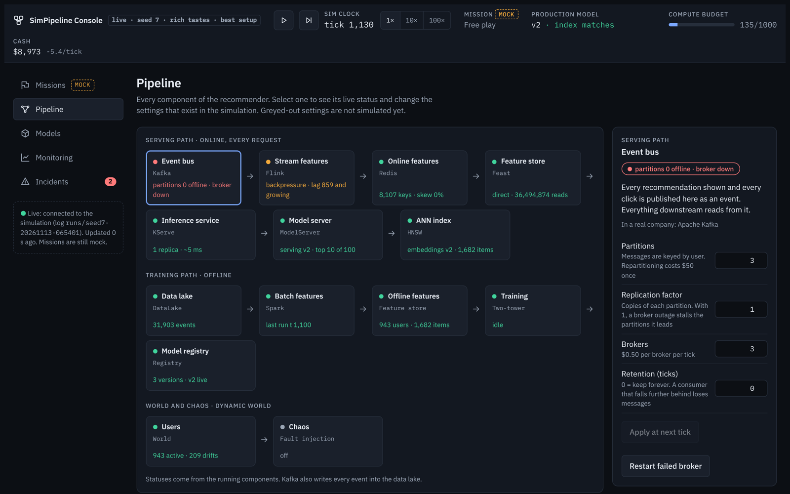
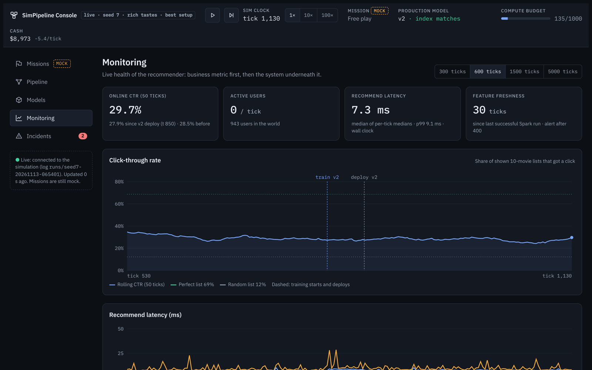
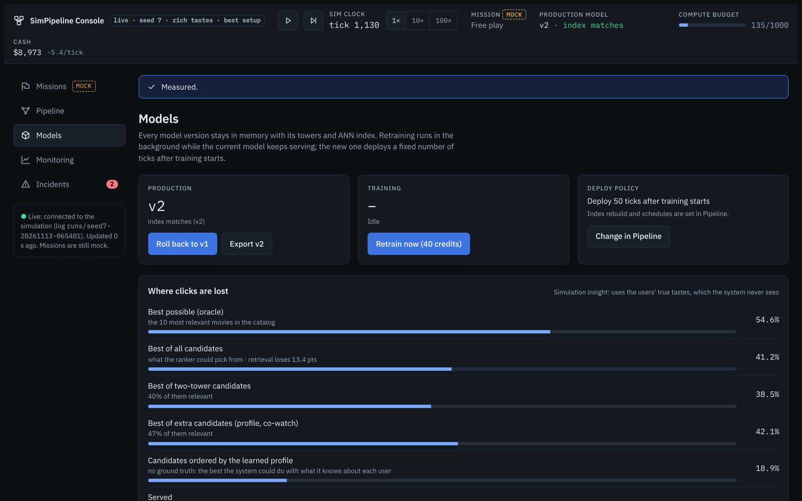
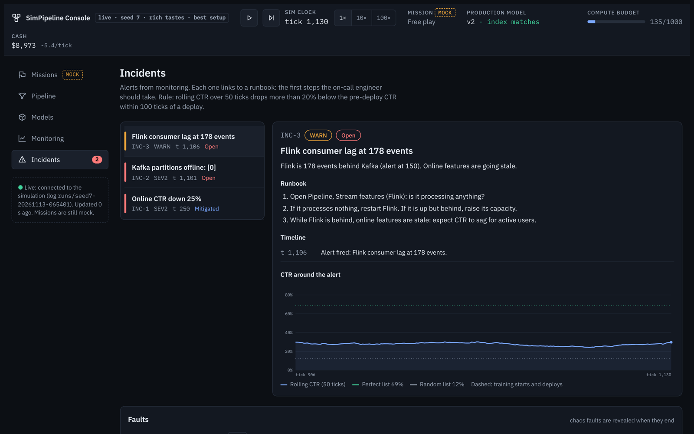
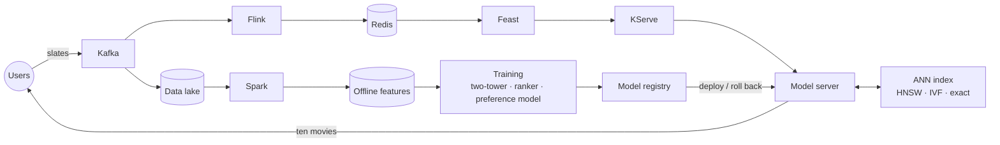
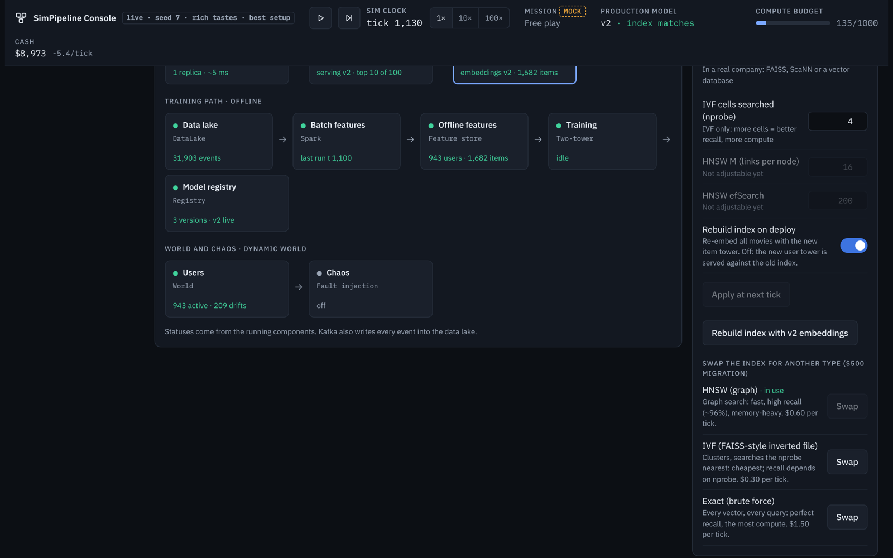

# SimPipeline

### Run a production recommender. Break it. Fix it. Make it pay.

SimPipeline is a game about the part of machine learning nobody teaches: **the system around
the model**. You get a live movie-recommendation platform, 943 users with real tastes, and the
whole production stack behind it: Kafka, Flink, Redis, Feast, a two-tower retriever, an ANN
index, rankers, KServe, Spark and a model registry. Your job is to keep it healthy, earn more
clicks than it costs, and make the recommendations good enough that people watch.

Every number you see is computed by a running simulation. When a broker goes down, lag really
builds up. When you deploy a model trained with a leak, click-through really drops. When you
cut replicas to save money, requests really spill over to the fallback.



---

## What a game looks like

1. **Start the clock.** Users arrive and get ten-movie slates from an untrained model. About
   one slate in seven gets a click.
2. **Retrain.** Spark rebuilds the features, the two-tower model and the ranker train in the
   background, and the new version deploys while the old one keeps serving. Click-through
   jumps from ~15% to ~45%, and keeps climbing as the system learns your users.
3. **Something breaks.** A Kafka broker dies, Flink falls behind, a bad index ships with
   the wrong movie ids, traffic triples. An incident opens with a runbook. You find the cause
   from the symptoms and fix it: restart, roll back, rebuild, scale.
4. **Watch the money.** Every click earns $1. Every broker, task slot, replica and index costs
   money every tick. Over-provision and you go broke; under-provision and your users get the
   popularity fallback.
5. **Rebuild the stack your way.** Swap the HNSW index for FAISS-style IVF or exact search,
   switch Feast to materialized features, add replicas, change the ranker, turn on exploration.
   Every change has a cost and a consequence you can measure.



## Why it's different

**The users are real people (almost).** The 943 simulated users carry the actual tastes of the
MovieLens volunteers: their genre preferences and hidden tastes learned from 100,000 real
ratings. They scan a slate from the top and get bored of seeing the same movie again. In the
dynamic world their tastes drift and new users sign up with no history. A model that only
learns genres plateaus. One that learns what the clicks are telling it gets far ahead.

**The ground truth is there when you want it.** Every user's true taste is known to the game
(never to your models). The *Where clicks are lost* report uses it to show, stage by stage,
how many clicks your retrieval, your ranker and your re-rankers leave on the table, measured
against the best slate that exists.



**The bugs are real bugs.** Train/serve skew, a stale index after a deploy, label leakage
through a feature computed after the click, position bias, feedback loops, cold start. They
were found while building the game, they are documented, and you can recreate them.

**Incidents feel like on-call.** Alert rules watch CTR, consumer lag, the fallback share, an ANN
self-test, online/offline feature skew, feature freshness, data drift, partitions offline,
serving overflow and your cash. Each incident has a runbook, a timeline and the CTR around it.
Turn on chaos and faults arrive unannounced, revealed only when they end.



**Everything is deterministic.** Same seed, same actions at the same ticks: the same game, down
to the trained weights. Replay a run, compare two strategies, share a seed with a friend.

## The stack you operate



| Component | What you control |
|---|---|
| **Kafka** | partitions, brokers, replication, retention; a broker outage stalls unreplicated partitions |
| **Flink** | task slots and throughput; rescaling is a savepoint and a restart; backpressure |
| **Redis** | memory limit and eviction policy, feature TTLs, hit rate |
| **Feast** | serve batch features directly or from a materialized online copy (and live with staleness) |
| **KServe** | replicas, capacity, autoscaling target, cold starts; overflow goes to the fallback |
| **ANN index** | **swappable**: HNSW, FAISS-style IVF (tune `nprobe`) or exact search; recall vs cost vs latency |
| **Model server** | candidates, slate size, extra candidate sources, rankers, diversity, exploration |
| **Training** | schedule, epochs, negatives, popularity correction, graded positives, tower inputs |
| **Registry** | canary rollouts and A/B tests with a significance test, an offline evaluation gate, roll back, export |
| **World** | static or dynamic users: taste drift, fatigue that wears off, rewatching, new sign-ups |



## Real ML inside

This isn't a toy model in a pretty UI. Under the hood:

- a **two-tower retriever** with sampling-bias (logQ) correction, served through a real HNSW
  graph (or IVF, or exact search);
- a **preference model** that learns from every logged signal (clicks, the movies skipped
  above a click, watch completion, ratings, onboarding answers, repeat exposure), online every
  tick and refitted at every retrain;
- an **MLP ranker** with position debiasing, movie signals from the logs (position-corrected
  click rates, co-watching) and **logged features** so it never trains on scores it couldn't
  have had at serving time;
- re-rankers for **diversity** (MMR) and **exploration**, candidate sources for profiles,
  co-watching and preferences, a feature store with **point-in-time** lookups.

With the default setup, click-through climbs from 15% to about 50% by tick 1,200 and 56% by
tick 4,000 in the static world. The best possible slate is 69%. How close can you get?

## Play in five minutes

You need Python 3.10+ (CPU only; no GPU needed).

```bash
git clone https://github.com/PrimozRavbar/SimPipelineExp.git
```

```bash
cd SimPipelineExp
```

```bash
pip install -e ".[console]"
```

```bash
python -m console --taste rich
```

Open <http://localhost:8000>, press play, and retrain when you're ready. Add `--world dynamic`
for changing users, `--seed 7` for a different game, `--preset plain` to start from the
original bare-bones stack and build it up yourself.

**On Colab:** open `SimPipExp_console.ipynb` and run it top to bottom; the console opens in a
new browser tab.

**Your first game:**

1. Press play at 10×. Watch Monitoring: CTR hovers around 13-15%.
2. At tick ~400, go to Models and press **Retrain now**. It deploys 50 ticks later.
3. Watch CTR climb. Open **Where clicks are lost** to see what's left on the table.
4. Go to Pipeline > Chaos and inject a **Kafka broker** drill. Find the incident. Fix it.
5. Check your cash in the top bar. Can you run the platform at a profit?

The full **[User Guide](docs/USER_GUIDE.md)** covers every screen, setting, fault and repair,
the money model and strategies that work.

## Who it's for

- **ML and data engineers** who want to practise production judgment: rollouts, incidents,
  skew, capacity, cost.
- **Students and career changers** who know models and want to see the system around them.
- **Teams and instructors**: run the same seed, compare strategies, hold game days.
- **Anyone who likes a management game** where the simulation is honest.

## What's next

Scripted missions with objectives and scoring (the Missions screen is a preview), more
swappable components, a component library to compose your own pipeline, more ML systems
beyond recommendations (fraud detection is next), and multiplayer game days.

## For developers

The simulation is plain Python: `world/` (users and their true tastes), `ml_system/` (the
production components and models), `console/` (the game session, API and web UI),
`dashboard/` (a static run report). `python -m pytest -q` runs the test suite.
`CLAUDE.md` is the engineering handbook: every component, every measurement, every bug found
and fixed. `SimPipExp_quickstart.ipynb` drives the simulation from code.

## License

SimPipeline is licensed under the **PolyForm Noncommercial License 1.0.0**.

The source is publicly available for permitted noncommercial use, subject to the terms of the
license. Commercial use requires separate permission.

Copyright © 2026 Primoz Ravbar.
